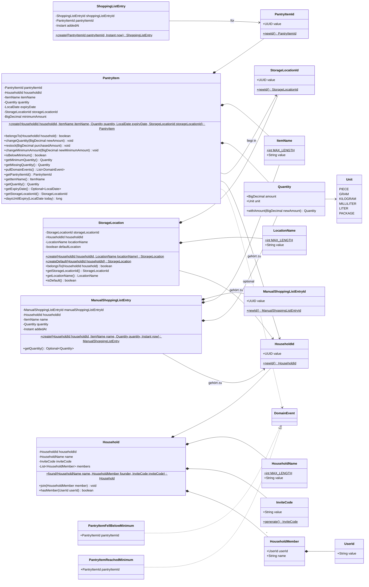
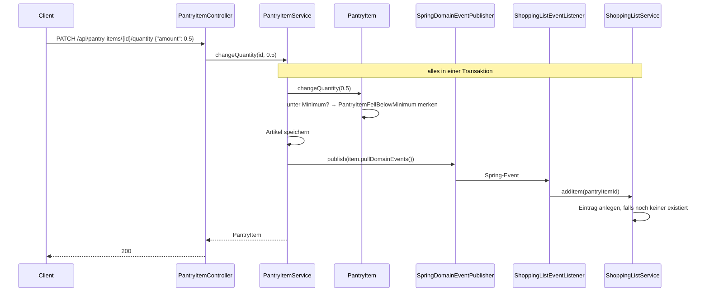
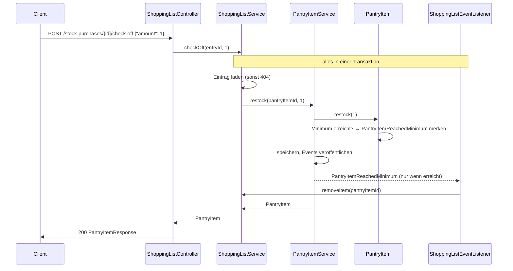
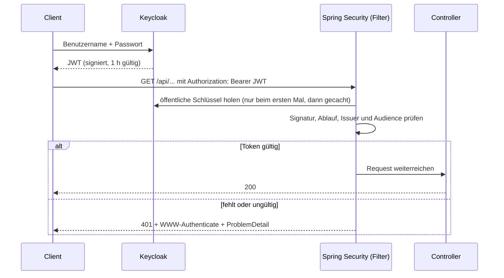
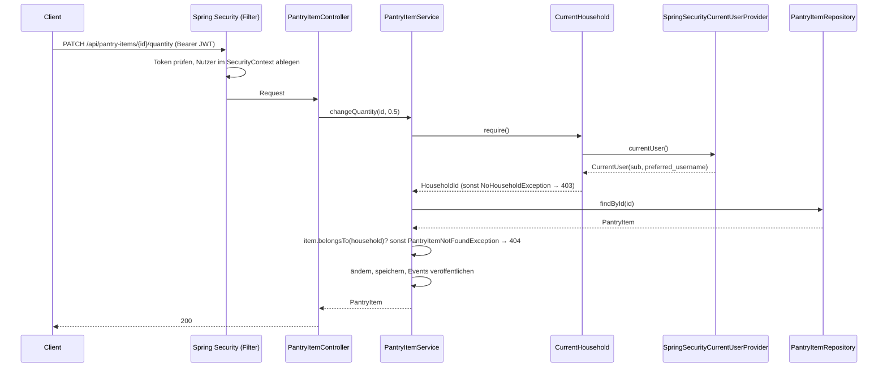
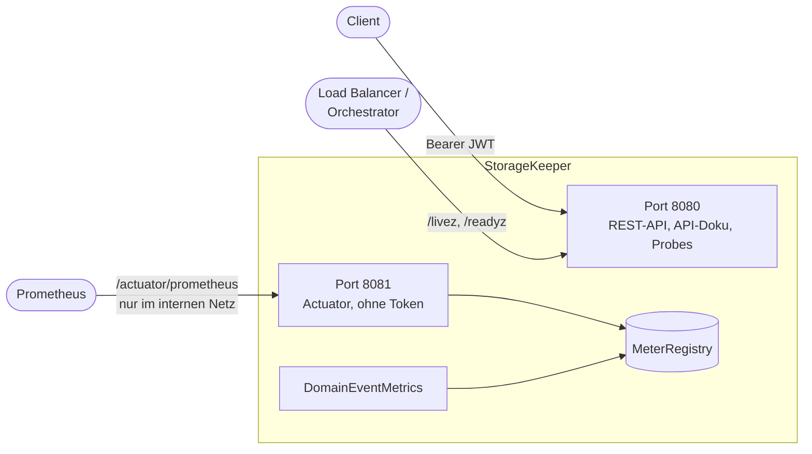
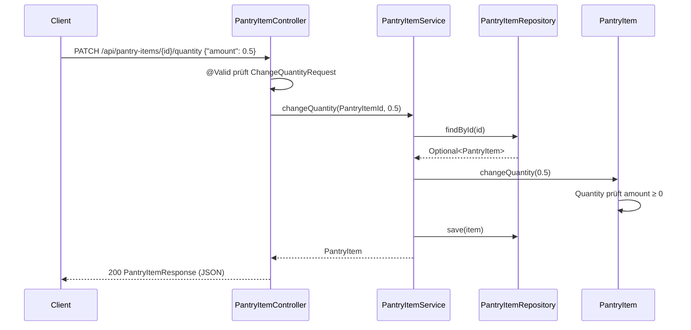

# Domain-Modell

Dieses Dokument beschreibt, wie die fachlichen Klassen von StorageKeeper aufgebaut sind, welche Regeln sie garantieren und wie ein Request durch die Schichten läuft.  
Stand: M6 Teil 1 (Betrieb: Health-Probes, Metriken mit Prometheus und strukturiertes Logging; Haushalte: jeder
Nutzer sieht nur den Vorrat seines Haushalts; API nur mit JWT erreichbar; Einkaufsliste mit Vorratseinkäufen über
Domain-Events und manuellen Einträgen; gespeichert in PostgreSQL).

## Grundbegriffe

| Begriff            | Bedeutung                                                                                                               | Umsetzung in Java                                            |
|--------------------|-------------------------------------------------------------------------------------------------------------------------|--------------------------------------------------------------|
| **Entity**         | Hat eine eigene Identität. Zwei Objekte sind gleich, wenn ihre ID gleich ist, auch wenn sich ihr Zustand unterscheidet. | Klasse; `equals`/`hashCode` nur über die ID                  |
| **Value Object**   | Hat keine Identität. Zwei Objekte sind gleich, wenn alle Werte gleich sind. Unveränderlich.                             | `record`                                                     |
| **Aggregate Root** | Einstiegspunkt für eine Gruppe zusammengehöriger Objekte. Änderungen laufen nur über ihn.                               | z. B. `PantryItem`, `Household`                              |
| **Invariante**     | Regel, die für ein Objekt immer gilt.                                                                                   | Prüfung im Konstruktor; Verstoß → `IllegalArgumentException` |

Weil jede Klasse ihre Regeln im Konstruktor prüft, kann im Programm kein ungültiges Objekt existieren.
Das Paket `domain` hängt von keinem Framework ab (kein Spring, kein Jakarta); `ArchitectureTest` erzwingt das.

## Klassendiagramm

## Klassen im Detail

### `PantryItem` – Entity, Aggregate Root

Ein Produkt im Vorrat, z. B. „1 kg Reis, haltbar bis 01.03.2027“.

| Feld                | Typ                 | Pflicht | Regel                                                                                 |
|---------------------|---------------------|---------|---------------------------------------------------------------------------------------|
| `pantryItemId`      | `PantryItemId`      | ja      | unveränderlich                                                                        |
| `householdId`       | `HouseholdId`       | ja      | Haushalt, dem der Artikel gehört; unveränderlich                                      |
| `itemName`          | `ItemName`          | ja      | unveränderlich                                                                        |
| `quantity`          | `Quantity`          | ja      | änderbar über `changeQuantity`                                                        |
| `expiryDate`        | `LocalDate`         | nein    | `null` = kein Ablaufdatum; nach außen als `Optional`                                  |
| `storageLocationId` | `StorageLocationId` | ja      | Lagerort des Artikels; Verweis nur über die ID                                        |
| `minimumAmount`     | `BigDecimal`        | ja      | Mindestbestand in der Einheit des Artikels, ≥ 0; `0` = kein Mindestbestand (Standard) |

- **Anlegen:** `PantryItem.create(...)` erzeugt eine neue ID. Der öffentliche Konstruktor ist für das
  Wiederherstellen eines vorhandenen Artikels mit bekannter ID gedacht (z. B. später aus der Datenbank).
- **Ändern:** `changeQuantity(newAmount)` setzt eine neue Menge; die Einheit bleibt gleich.
  Eine negative Menge wird von `Quantity` abgelehnt.
- **Auffüllen:** `restock(purchasedAmount)` addiert eine gekaufte Menge zum Bestand (muss > 0 sein).
  Intern ruft es `changeQuantity` auf und löst deshalb dieselben Events aus.
- **Gleichheit:** nur über `pantryItemId`. Ein Artikel bleibt derselbe, auch wenn sich seine Menge ändert.
- **Ablauf:** `daysUntilExpiry(today)` liefert die Tage bis zum Ablaufdatum: `0` = läuft heute ab,
  negativ = schon abgelaufen. Das „heute“ wird übergeben, die Domain fragt nie selbst die Uhr
  (siehe Abschnitt „Ablaufdatum und aktuelle Zeit“). Ohne Ablaufdatum wirft die Methode
  eine `IllegalStateException`.
- **Mindestbestand:** `changeMinimumAmount(amount)` setzt ihn, `getMinimumQuantity()` liefert ihn als `Quantity`
  mit der Einheit des Artikels. Eine eigene Einheit hat der Mindestbestand bewusst nicht, damit „2 kg Mindestbestand
  bei einer Menge in Stück“ gar nicht erst entstehen kann. `isBelowMinimum()` ist `true`, wenn die Menge **kleiner**
  als der Mindestbestand ist; genau gleich viel gilt als ausreichend. Das ist die Grundlage für die Einkaufsliste in M4.
- **Lagerort:** Jeder Artikel liegt in genau einem Lagerort. `PantryItem` hält dafür nur die `StorageLocationId`,
  nicht das `StorageLocation`-Objekt selbst (siehe unten).
- **Haushalt:** `belongsTo(household)` sagt, ob der Artikel zu diesem Haushalt gehört. Damit prüfen die Services,
  ob der angemeldete Nutzer ihn sehen und ändern darf (siehe „Haushalte und Autorisierung“).

### `PantryItemId` – Value Object

Kapselt eine `UUID`. Ein eigener Typ statt einer nackten `UUID` verhindert, dass IDs verschiedener
Entities verwechselt werden, sobald es weitere gibt (z. B. Lagerorte in M3).

| Feld    | Typ    | Regel        |
|---------|--------|--------------|
| `value` | `UUID` | nicht `null` |

`newId()` erzeugt eine zufällige ID, `toString()` liefert nur die UUID (wird z. B. für die URL verwendet).

### `ItemName` – Value Object

| Feld    | Typ      | Regel                                                                                                                          |
|---------|----------|--------------------------------------------------------------------------------------------------------------------------------|
| `value` | `String` | nicht `null`, nicht leer; wird mit `strip()` von Leerzeichen befreit; höchstens `MAX_LENGTH` = 100 Zeichen (nach dem Strippen) |

### `Quantity` – Value Object

| Feld     | Typ          | Regel                                         |
|----------|--------------|-----------------------------------------------|
| `amount` | `BigDecimal` | nicht `null`, ≥ 0 (0 bedeutet „aufgebraucht“) |
| `unit`   | `Unit`       | nicht `null`                                  |

`BigDecimal` statt `double`, damit Mengen wie 0,1 exakt bleiben.
`withAmount(newAmount)` liefert eine **neue** `Quantity` mit gleicher Einheit; das Objekt selbst ändert sich nie.

### `Unit` – Enum

`PIECE`, `GRAM`, `KILOGRAM`, `MILLILITER`, `LITER`, `PACKAGE`.
Umrechnungen zwischen Einheiten gibt es bewusst (noch) nicht.

### `StorageLocation` – Entity, eigenes Aggregat

Ein Ort, an dem Vorräte liegen, z. B. „Kühlschrank“ oder „Keller“.

| Feld                | Typ                 | Pflicht | Regel                                                           |
|---------------------|---------------------|---------|-----------------------------------------------------------------|
| `storageLocationId` | `StorageLocationId` | ja      | unveränderlich                                                  |
| `householdId`       | `HouseholdId`       | ja      | Haushalt, dem der Lagerort gehört; unveränderlich               |
| `locationName`      | `LocationName`      | ja      | eindeutig im Haushalt, ohne Rücksicht auf Groß-/Kleinschreibung |
| `defaultLocation`   | `boolean`           | ja      | `true` für den Basis-Lagerort; genau einer pro Haushalt         |

- **Basis-Lagerort:** Jeder Haushalt bekommt beim Anlegen genau einen Basis-Lagerort „Vorrat“
  (`StorageLocation.createDefault(householdId)`, angelegt von `HouseholdService`). `isDefault()` liefert für ihn `true`.
  Bis M4 gab es dafür eine feste ID (`StorageLocationId.DEFAULT`); mit mehreren Haushalten braucht jeder seinen eigenen.
- **Standard beim Anlegen:** Gibt der Nutzer beim Anlegen eines Artikels keinen Lagerort an,
  setzt `PantryItemService` den Basis-Lagerort des Haushalts ein. Ein angegebener Lagerort muss existieren
  und zum Haushalt gehören.
- **Weitere Lagerorte** legt nur der Nutzer an (`POST /api/storage-locations`).
- **Eindeutige Namen:** `StorageLocationService` lehnt einen Namen ab, den es im Haushalt schon gibt
  („Keller“ = „keller“). Andere Haushalte dürfen denselben Namen verwenden. Zusätzlich sichert ein Unique-Index
  in der Datenbank das ab.

**Warum nur die ID im Artikel?** Artikel und Lagerort sind zwei getrennte Aggregate: Ein Lagerort
existiert unabhängig von seinen Artikeln, und beide werden getrennt geändert. Würde `PantryItem` das
ganze `StorageLocation`-Objekt halten, müsste beim Laden eines Artikels immer der Lagerort mitgeladen werden,
und Änderungen am einen könnten versehentlich den anderen betreffen. Der Verweis über die ID hält beide unabhängig.

### `StorageLocationId` – Value Object

Wie `PantryItemId`: kapselt eine `UUID`, `newId()` erzeugt eine zufällige ID.

### `LocationName` – Value Object

| Feld    | Typ      | Regel                                                                                                     |
|---------|----------|-----------------------------------------------------------------------------------------------------------|
| `value` | `String` | nicht `null`, nicht leer; wird mit `strip()` von Leerzeichen befreit; höchstens `MAX_LENGTH` = 50 Zeichen |

### `ShoppingListEntry` – Entity, eigenes Aggregat

Ein Artikel, der gekauft werden soll. Es gibt höchstens einen Eintrag pro Artikel.

| Feld                  | Typ                   | Pflicht | Regel                                      |
|-----------------------|-----------------------|---------|--------------------------------------------|
| `shoppingListEntryId` | `ShoppingListEntryId` | ja      | unveränderlich                             |
| `pantryItemId`        | `PantryItemId`        | ja      | Verweis auf den Artikel nur über die ID    |
| `addedAt`             | `Instant`             | ja      | Zeitpunkt, an dem der Eintrag entstand     |

Wie viel gekauft werden muss, steht nicht im Eintrag, sondern wird beim Anzeigen aus dem Artikel berechnet
(`PantryItem.getMissingQuantity()` = Mindestbestand − Menge). So passt die Zahl immer zum aktuellen Bestand.

### `ManualShoppingListEntry` – Entity, eigenes Aggregat

Etwas, das der Nutzer selbst auf die Liste schreibt, z. B. „Geburtstagskerzen“. Es hängt an keinem Artikel.

| Feld                        | Typ                         | Pflicht | Regel                                         |
|-----------------------------|-----------------------------|---------|-----------------------------------------------|
| `manualShoppingListEntryId` | `ManualShoppingListEntryId` | ja      | unveränderlich                                |
| `householdId`               | `HouseholdId`               | ja      | Haushalt, auf dessen Liste der Eintrag steht  |
| `name`                      | `ItemName`                  | ja      | dieselben Regeln wie beim Artikelnamen        |
| `quantity`                  | `Quantity`                  | nein    | `null` = ohne Mengenangabe; wenn gesetzt, > 0 |
| `addedAt`                   | `Instant`                   | ja      | Zeitpunkt, an dem der Eintrag entstand        |

**Warum eine eigene Klasse statt `ShoppingListEntry` mit optionalem Artikel?** Die beiden verhalten sich
verschieden: Ein Vorratseinkauf entsteht und verschwindet automatisch und ändert beim Abhaken den Bestand,
ein manueller Eintrag wird vom Nutzer angelegt und beim Abhaken einfach gelöscht. Mit einer Klasse bräuchte
jede Methode eine Fallunterscheidung „mit oder ohne Artikel“.

### `ManualShoppingListEntryId` – Value Object

Wie `PantryItemId`: kapselt eine `UUID`, `newId()` erzeugt eine zufällige ID.

### `Household` – Entity, Aggregate Root

Eine Gruppe von Nutzern, die einen Vorrat teilen: Artikel, Lagerorte und Einkaufsliste.

| Feld          | Typ                     | Pflicht | Regel                                                |
|---------------|-------------------------|---------|------------------------------------------------------|
| `householdId` | `HouseholdId`           | ja      | unveränderlich                                       |
| `name`        | `HouseholdName`         | ja      | nicht leer, höchstens 50 Zeichen (nach dem Strippen) |
| `inviteCode`  | `InviteCode`            | ja      | eindeutig über alle Haushalte                        |
| `members`     | `List<HouseholdMember>` | ja      | in Beitrittsreihenfolge; kein Nutzer doppelt         |

- **Anlegen:** `Household.found(name, founder, inviteCode)` erzeugt eine neue ID; der Gründer ist das erste Mitglied.
- **Beitreten:** `join(member)` hängt ein Mitglied an; ist der Nutzer schon Mitglied, gibt es eine
  `IllegalStateException`.
- **Ein Haushalt pro Nutzer:** Diese Regel betrifft mehrere Haushalte und lässt sich deshalb nicht in einem
  `Household` prüfen. `HouseholdService` prüft sie vor dem Anlegen und Beitreten, die Datenbank sichert sie ab
  (Primärschlüssel `household_member.user_id`).
- Ein Haushalt **ohne Mitglieder** ist erlaubt, aber nur für den Haushalt, den die Migration für alte Daten anlegt.
- Die anderen Aggregate verweisen nur über die `HouseholdId` auf ihn, wie ein Artikel auf seinen Lagerort.

### `HouseholdMember`, `UserId`, `InviteCode` – Value Objects

| Typ               | Felder           | Regel                                                                                                   |
|-------------------|------------------|---------------------------------------------------------------------------------------------------------|
| `UserId`          | `value`          | ID des Nutzers beim Identity Provider (JWT-Claim `sub`), nicht leer, höchstens 255 Zeichen              |
| `HouseholdMember` | `userId`, `name` | `name` ist nur zur Anzeige (`preferred_username` beim Beitritt), nicht leer, höchstens 255 Zeichen      |
| `InviteCode`      | `value`          | Form `XXXX-XXXX` aus `A–Z` und `2–9` ohne `0`, `O`, `1`, `I`; Eingabe wird getrimmt und großgeschrieben |

- **Warum `sub` und nicht der Benutzername?** Den Benutzernamen kann man in Keycloak ändern; `sub` bleibt gleich.
  Nutzer werden nur im Identity Provider verwaltet, die App speichert nur, wer in welchem Haushalt ist.
- **Einladungscode:** `InviteCode.generate()` zieht 8 Zeichen mit `SecureRandom` aus 32 möglichen, also etwa
  10¹² Codes; erraten ist praktisch ausgeschlossen. Verwechselbare Zeichen fehlen, damit man den Code auch
  vorlesen oder abtippen kann.

### Domain-Events

Ein Domain-Event beschreibt, dass in der Domain etwas passiert ist, auf das andere Teile reagieren können.
Events sind einfache `record`s ohne Framework-Typen und implementieren das Marker-Interface `DomainEvent`.

| Event                        | Wann                                                                      |
|------------------------------|---------------------------------------------------------------------------|
| `PantryItemFellBelowMinimum` | Menge ist nach einer Änderung **unter** dem Mindestbestand, vorher nicht  |
| `PantryItemReachedMinimum`   | Menge ist nach einer Änderung **nicht mehr** darunter, vorher schon       |

- Ausgelöst werden sie nur beim **Überschreiten der Grenze**, nicht bei jeder Änderung:
  von 5 auf 4 bei Mindestbestand 3 passiert nichts.
- Beide Richtungen gibt es über `changeQuantity` und über `changeMinimumAmount`
  (ein höherer Mindestbestand kann einen Artikel genauso „unter Minimum“ bringen wie ein Verbrauch).
- `PantryItem` sammelt die Events intern; `pullDomainEvents()` gibt sie heraus und leert die Liste,
  damit jedes Event nur einmal verarbeitet wird.
- Das Wiederherstellen eines Artikels aus der Datenbank (Konstruktor) ist keine Änderung und erzeugt kein Event.
- Zwei Adapter hören zu: `ShoppingListEventListener` pflegt die Einkaufsliste, `DomainEventMetrics` zählt die Events
  für die Metriken (siehe „Betrieb“).

## Einkaufsliste

`GET /api/shopping-list` liefert die Liste in zwei Abschnitten, jeweils älteste zuerst:

| Abschnitt         | JSON-Feld        | Inhalt                                   | Entsteht            | Abhaken                                   |
|-------------------|------------------|------------------------------------------|---------------------|-------------------------------------------|
| Vorratseinkäufe   | `stockPurchases` | `ShoppingListEntry` + Artikel            | automatisch         | gekaufte Menge wird zum Bestand addiert   |
| Einkaufsliste     | `manualEntries`  | `ManualShoppingListEntry`                | vom Nutzer          | Eintrag wird gelöscht                     |

In der Application fasst `ShoppingList(stockPurchases, manualEntries)` beide Abschnitte zusammen
(`ListShoppingListUseCase.getShoppingList()`).

### Vorratseinkäufe entstehen automatisch

Fällt ein Artikel unter seinen Mindestbestand, kommt er auf die Liste; erreicht er ihn wieder, verschwindet er.
Jeder Eintrag zeigt `missingAmount`.

**Warum Events statt eines direkten Aufrufs?** `PantryItemService` müsste sonst die Einkaufsliste kennen und
bei jeder Mengenänderung selbst entscheiden, ob dort etwas zu tun ist. Mit Events meldet der Artikel nur
„ich bin unter Minimum“, und wer sich dafür interessiert, reagiert. In M5/M6 können weitere Reaktionen
(z. B. eine Benachrichtigung) dazukommen, ohne den bestehenden Code anzufassen.

**Wie die Teile zusammenhängen:**

- `DomainEventPublisher` ist ein Port in `application.port.out`. Die Application kennt nur dieses Interface.
- `adapter.out.event.SpringDomainEventPublisher` implementiert ihn mit Springs `ApplicationEventPublisher`.
- `adapter.in.event.ShoppingListEventListener` empfängt die Events (`@EventListener`) und ruft den Use Case
  `UpdateShoppingListUseCase` auf. Er ist ein **treibender Adapter**, genau wie ein REST-Controller:
  Er übersetzt nur und enthält keine Regeln.
- `ShoppingListService` legt Einträge an (nur, wenn noch keiner existiert) und entfernt sie.

**Transaktionen:** `PantryItemService.add`, `changeQuantity` und `changeMinimumAmount` sind `@Transactional`.
Spring ruft die Listener synchron im selben Thread auf, deshalb laufen Änderung am Artikel und Änderung an der
Einkaufsliste in **einer** Transaktion: Schlägt das Anlegen des Eintrags fehl, wird auch die Mengenänderung
zurückgerollt. Artikel und Liste können so nicht auseinanderlaufen.

**Löschen:** Wird ein Artikel gelöscht, löscht die Datenbank seinen Eintrag mit (`ON DELETE CASCADE`).

### Vorratseinkauf abhaken

`POST /api/shopping-list/stock-purchases/{id}/check-off` mit `{"amount": 1}` meldet, wie viel gekauft wurde.

- **Teilkauf:** Fehlen 3 kg und es wird 1 kg gekauft, steigt der Bestand um 1 kg. Der Artikel ist weiter unter
  dem Minimum, es gibt kein Event, und der Eintrag bleibt mit `missingAmount` 2 stehen.
- **Vollständig gekauft:** Erreicht der Bestand das Minimum, löst `PantryItem` `PantryItemReachedMinimum` aus,
  und der Listener entfernt den Eintrag. Mehr als fehlt zu kaufen ist erlaubt.
- `ShoppingListService.checkOff` entfernt den Eintrag **nicht** selbst. Ob der Artikel genug hat, entscheidet
  allein `PantryItem`; so gibt es diese Regel nur an einer Stelle.
- Den Bestand ändert `ShoppingListService` nicht direkt, sondern über den Use Case `RestockPantryItemUseCase`
  (implementiert von `PantryItemService`). Laden, Speichern und Events veröffentlichen bleiben damit an einer Stelle.

### Manuelle Einträge

- `POST /api/shopping-list/manual-entries` mit `{"name", "amount"?, "unit"?}` legt einen Eintrag an (`201`).
  Menge und Einheit sind optional, aber nur zusammen; sonst `400`. Die Menge muss > 0 sein.
- `DELETE /api/shopping-list/manual-entries/{id}` hakt ihn ab, also löscht ihn (`204`, unbekannt → `404`).
- Manuelle Einträge haben keinen Bezug zum Vorrat. Wer etwas Gekauftes in den Vorrat übernehmen will,
  legt dafür einen Artikel an.

## Ablaufdatum und aktuelle Zeit

`GET /api/pantry-items/expiring?days=7` liefert alle Artikel, die in den nächsten `days` Tagen ablaufen
oder schon abgelaufen sind, sortiert nach Ablaufdatum. Artikel ohne Ablaufdatum tauchen nicht auf.

| `days`        | Ergebnis                                        |
|---------------|-------------------------------------------------|
| weggelassen   | 7                                               |
| `0`           | nur Artikel, die heute oder früher ablaufen     |
| `0` bis `365` | erlaubt; alles andere → `400`                   |

**Woher kommt „heute“?** Nicht aus `LocalDate.now()` mitten im Code, sondern aus einer
`java.time.Clock`, die per Konstruktor in `PantryItemService` kommt:

- **In der App** legt `config/ClockConfiguration` eine Systemuhr in der Zeitzone aus
  `storagekeeper.time-zone` an (`application.yaml`, Standard `Europe/Berlin`). Die Zeitzone entscheidet,
  wann ein neuer Tag beginnt. Ohne sie würde ein Server in UTC um 0:30 Uhr deutscher Zeit noch „gestern“ rechnen.
- **In Tests** wird eine feste Uhr übergeben (`Clock.fixed(...)`). „Heute“ ist dann immer derselbe Tag,
  und Tests wie „läuft in 3 Tagen ab“ liefern an jedem Tag dasselbe Ergebnis.

`Clock` ist Teil des JDK, deshalb braucht es dafür kein eigenes Port-Interface: Die Application hängt
weiterhin nur vom JDK ab, nicht von Spring.

Ablauf einer Abfrage:

1. `PantryItemService.listExpiringWithin(days)` bestimmt `today = LocalDate.now(clock)`.
2. Das Repository liefert alle Artikel mit `expiry_date <= today + days`. Gefiltert und sortiert wird
   in der Datenbank (Index aus Migration V3), nicht in Java.
3. Für jeden Artikel berechnet die Domain `daysUntilExpiry(today)`. Ergebnis ist ein
   `ExpiringPantryItem(item, daysUntilExpiry)` mit `expired()` = `daysUntilExpiry < 0`.

## Artikelliste: Filter und Paging

`GET /api/pantry-items` liefert die Artikel seitenweise und nach Name sortiert. Alle Filter sind optional und
werden mit UND verknüpft:

| Parameter           | Standard | Bedeutung                                         |
|---------------------|----------|---------------------------------------------------|
| `storageLocationId` | –        | nur Artikel in diesem Lagerort                    |
| `belowMinimum`      | `false`  | `true` = nur Artikel unter ihrem Mindestbestand   |
| `page`              | `0`      | Seite, beginnend bei 0                            |
| `size`              | `20`     | Einträge pro Seite, 1 bis 100                     |

Die Antwort ist ein Seitenobjekt: `{"content": [...], "page", "size", "totalElements", "totalPages"}`.

**Eigene Typen statt Spring Data:** Die Application-Schicht verwendet `PageQuery(page, size)` und
`ResultPage<T>(content, page, size, totalElements)` aus `application.port` statt `Pageable` und `Page`
von Spring Data. So hängt die Application weiterhin nicht von der Persistenz-Technik ab; erst
`JpaPantryItemRepository` übersetzt in `PageRequest` und zurück. `PageQuery` prüft selbst, dass `page ≥ 0`
und `size` zwischen 1 und 100 liegt.

**Filtern in der Datenbank:** Die Filter werden als JPA-`Specification`s formuliert
(`PantryItemSpecifications`: `inStorageLocation`, `belowMinimum`). `JpaPantryItemRepository` hängt nur die
Bedingungen an, die im `PantryItemFilter` gesetzt sind, und Spring Data erzeugt daraus eine SQL-Abfrage
mit `WHERE`, `ORDER BY name, id`, `LIMIT` und `OFFSET` plus eine `COUNT`-Abfrage für `totalElements`.
Sortiert wird zusätzlich nach `id`, damit Artikel mit gleichem Namen auf jeder Seite in derselben Reihenfolge
stehen und keiner auf zwei Seiten auftaucht.

## Anmeldung (Authentifizierung)

Die REST-API ist ein **OAuth2 Resource Server**: Sie stellt selbst keine Tokens aus und verwaltet keine Passwörter,
sondern prüft nur die JWTs, die ein Identity Provider ausgestellt hat (lokal: Keycloak aus `compose.yaml`).

- **Was geprüft wird:** Signatur (mit den Schlüsseln des Issuers), Ablaufzeit, Issuer (`iss` muss
  `spring.security.oauth2.resourceserver.jwt.issuer-uri` sein) und Audience (`aud` muss `storagekeeper-api`
  enthalten). Die Audience-Prüfung verhindert, dass ein Token, das derselbe Keycloak für eine ganz andere
  Anwendung ausgestellt hat, auch hier funktioniert.
- **Öffentlich** sind nur die Health-Probes `/livez` und `/readyz`, `/v3/api-docs` und die Swagger UI; alles andere
  auf Port `8080` verlangt ein Token. Actuator läuft auf dem eigenen Port `8081`, siehe „Betrieb“.
- **Ohne Sitzung:** Jeder Request bringt sein Token mit; der Server merkt sich nichts (`STATELESS`). Weil es
  dadurch auch kein Sitzungs-Cookie gibt, ist CSRF-Schutz unnötig und abgeschaltet.
- **Wo:** `adapter.in.web.SecurityConfiguration`. Anmeldung gehört zum Web-Adapter; Domain und Application
  wissen davon nichts.
- **Antwort bei `401`:** Der Standard-Entry-Point von Spring Security setzt Status und Header `WWW-Authenticate`
  (RFC 6750, z. B. `error="invalid_token"`), schreibt aber keinen Body. Damit `401` wie jeder andere Fehler als
  `ProblemDetail` kommt, ruft der Entry-Point in `SecurityConfiguration` danach Springs `HandlerExceptionResolver`
  auf; der leitet die `AuthenticationException` an `ApiExceptionHandler` weiter. Der Umweg ist nötig, weil der
  Security-Filter vor Spring MVC läuft und `@RestControllerAdvice` die Exception sonst nie zu sehen bekäme.
  `detail` ist bei fehlendem Token „A valid bearer token is required.“, bei ungültigem Token der Grund
  (z. B. abgelaufen).

Der Filter prüft nur, **wer** der Nutzer ist (Authentifizierung). **Was** er sehen darf (Autorisierung),
entscheidet der Application-Layer, siehe nächster Abschnitt.

**In Tests** braucht es keinen Keycloak: Die Controller-Tests laufen mit `@WithMockUser` als angemeldeter Nutzer,
`ApiSecurityTest` prüft die Regeln mit der echten Filterkette und setzt per `jwt()` ein bereits geprüftes Token ein.

## Haushalte und Autorisierung

Alle Daten gehören zu genau einem Haushalt: Artikel, Lagerorte und manuelle Einträge haben eine `householdId`,
ein Vorratseinkauf gehört zum Haushalt seines Artikels. Ein Nutzer ist in höchstens einem Haushalt und sieht nur
dessen Daten.

### Haushalt anlegen und beitreten

| Endpunkt                   | Use Case                 | Was passiert                                                                         |
|----------------------------|--------------------------|--------------------------------------------------------------------------------------|
| `POST /api/household`      | `CreateHouseholdUseCase` | neuer Haushalt mit Einladungscode und Basis-Lagerort; der Nutzer ist erstes Mitglied |
| `GET /api/household`       | `ShowHouseholdUseCase`   | eigener Haushalt mit Code und Mitgliedern                                            |
| `POST /api/household/join` | `JoinHouseholdUseCase`   | Nutzer wird Mitglied des Haushalts mit diesem Code                                   |

Wer schon in einem Haushalt ist, kann keinen weiteren anlegen oder beitreten (`409`). Austreten und Mitglieder
entfernen gibt es (noch) nicht.

### Wo die Prüfung stattfindet

- **Im Application-Layer:** Jeder Service fragt zuerst `CurrentHousehold.require()` nach dem Haushalt des
  angemeldeten Nutzers. Einzelne Objekte prüft er mit `belongsTo(household)`; Listen fragt er gleich mit der
  `HouseholdId` beim Repository an, damit in der Datenbank gefiltert wird. Controller und Domain wissen nichts
  davon: Die Controller haben sich durch M5 nicht geändert, und `PantryItem` kennt nur seine eigene `HouseholdId`.
- **Warum nicht im Controller oder Filter?** Die Regel „nur der eigene Haushalt“ ist fachlich und gilt für jeden
  Weg in die Anwendung, nicht nur für REST. Im Application-Layer kann man sie ohne HTTP testen
  (`PantryItemServiceTest`), und kein neuer Controller kann sie vergessen.
- **Woher kennt die Application den Nutzer?** Über den Port `CurrentUserProvider` (`application.port.out`).
  `adapter.out.security.SpringSecurityCurrentUserProvider` liest ihn aus Springs `SecurityContext`: `sub` als
  `UserId`, `preferred_username` als Anzeigename. So hängt die Application nicht von Spring Security ab.
- **Fremde Daten sind „nicht gefunden“:** Ein Artikel oder Eintrag eines anderen Haushalts ergibt `404`, nicht
  `403`. So verrät die Antwort nicht, dass es die ID gibt.
- **Ohne Haushalt** ergibt jeder Use Case auf Vorratsdaten `NoHouseholdException` (`403`,
  „Create or join a household first.“).
- **Einkaufsliste aus Events:** `UpdateShoppingListUseCase` (vom `ShoppingListEventListener` aufgerufen) prüft
  nicht erneut. Er reagiert nur auf Änderungen, die schon geprüft wurden.
- **Zusätzlich in der Datenbank:** Ein Fremdschlüssel `(storage_location_id, household_id)` verhindert, dass ein
  Artikel in einem Lagerort eines anderen Haushalts landet, selbst wenn der Code einmal falsch prüfen sollte.

## API-Dokumentation

springdoc erzeugt aus den Controllern ein OpenAPI-3-Dokument (`/v3/api-docs`) und die Swagger UI (`/swagger-ui.html`).
`adapter.in.web.OpenApiConfiguration` ergänzt nur Titel und Beschreibung und meldet das Bearer-Schema an,
damit die Swagger UI einen „Authorize“-Knopf zeigt. Die Gruppen in der Swagger UI kommen aus `@Tag` an den Controllern.

## Betrieb: Health, Metriken, Logging

Betrieb ist reine Adapter- und Konfigurationssache; Domain und Application wissen davon nichts.
Es gibt keine neue Tabelle und keine Migration.

### Zwei Ports

| Port   | Kontext                                | Security-Chain                                         |
|--------|----------------------------------------|--------------------------------------------------------|
| `8080` | Anwendung (Controller, Probes, Doku)   | `apiSecurity`: JWT, außer Probes und Doku              |
| `8081` | Actuator (`management.server.port`)    | `managementSecurity`: alles ohne Token (`permitAll`)   |

- Spring Boot startet für `8081` einen eigenen Webserver mit eigenem Kind-Kontext. Die Security-Filterkette
  gilt auf beiden Ports; `SecurityConfiguration.ManagementSecurity` hat deshalb `@Order(1)` und greift nur für
  `EndpointRequest.toAnyEndpoint()`. Bei getrenntem Port passt dieser Matcher nur auf Requests an `8081`,
  `/actuator/prometheus` auf `8080` landet also in `apiSecurity` und ergibt `401`.
- `@ConditionalOnManagementPort(DIFFERENT)`: Stellt jemand den Management-Port auf `8080`, gibt es die offene
  Chain gar nicht. Dann sind wie vor M6 nur Health und Info öffentlich, Metriken brauchen ein Token.
- **Warum nicht alles auf `8080` mit Token?** Prometheus müsste sich dann bei Keycloak Tokens holen. Ein interner
  Port ohne Anmeldung ist das übliche Muster; er wird im Deployment einfach nicht veröffentlicht.

### Health-Gruppen

| Gruppe      | Prüfungen                  | Auf `8080`  | Details                              |
|-------------|----------------------------|-------------|--------------------------------------|
| (gesamt)    | alle (db, diskSpace, ssl …) | –           | ja (nur auf `8081`)                  |
| `liveness`  | `livenessState`            | `/livez`    | nein                                 |
| `readiness` | `readinessState`, `db`     | `/readyz`   | nur Status je Prüfung, keine Details |

Die Datenbank gehört bewusst nur zur Readiness: Ist sie weg, kann die App nichts tun und soll keinen Traffic
bekommen, ein Neustart der App würde aber nichts reparieren.

### Metriken

- Micrometer sammelt die Messwerte in einer `MeterRegistry`; `micrometer-registry-prometheus` stellt sie unter
  `/actuator/prometheus` bereit. Alle bekommen das Label `application` (`management.metrics.tags`).
- `http.server.requests` hat zusätzlich Histogramm-Buckets, damit Prometheus Perzentile (z. B. p95) über mehrere
  Instanzen berechnen kann.
- `adapter.in.event.DomainEventMetrics` hört auf jedes `DomainEvent` und zählt es im Counter
  `storagekeeper.domain.events` mit dem Tag `type` (einfacher Klassenname). Weil es nur wenige Event-Typen gibt,
  bleibt die Zahl der Zeitreihen klein; IDs oder Haushalte gehören deshalb **nicht** in Tags.
- Gezählt wird mit `@TransactionalEventListener(AFTER_COMMIT)`: Events werden mitten in der Transaktion
  veröffentlicht, und eine zurückgerollte Änderung soll nicht in der Statistik auftauchen. Die Einkaufsliste
  dagegen hört weiter mit `@EventListener` in derselben Transaktion, damit Bestand und Liste zusammen gespeichert
  oder zusammen verworfen werden.

### Logging

- Das Format stellt `logging.structured.format.console` ein (`STORAGEKEEPER_LOG_FORMAT`). Leer = Text,
  `ecs` = eine JSON-Zeile pro Eintrag im Elastic Common Schema.
- `adapter.in.web.UserLoggingContextFilter` legt nach der Token-Prüfung die Nutzer-ID als `user.id` in den
  MDC (Mapped Diagnostic Context) von SLF4J. Alle Logzeilen dieses Requests, egal aus welcher Schicht,
  enthalten sie dann automatisch. Am Ende des Requests wird der Eintrag wieder entfernt, weil Tomcat den Thread
  für den nächsten Request wiederverwendet.
- Der Filter ist absichtlich keine `@Component`: Spring Boot würde jeden Filter-Bean zusätzlich als normalen
  Servlet-Filter registrieren, dann liefe er ein zweites Mal vor der Security und fände dort noch keinen Nutzer.
- Die Application loggt fachlich wichtige Vorgänge mit SLF4J, z. B. `HouseholdService` „Household … founded“
  und Beitritte. SLF4J ist nur eine Logging-Schnittstelle, kein Framework; die Domain loggt nicht.

## Schichten und Abhängigkeiten

- Abhängigkeiten zeigen immer nach innen: Adapter → Application → Domain.
- Die Application kennt nur die Interfaces in `port.out`, nicht deren Implementierung.

Beim Wechsel von der In-Memory-Liste (M1) auf PostgreSQL (M2) haben sich Service und Domain deshalb nicht geändert.

## Ablauf eines Requests

Beispiel: Menge ändern.

## Abbildung REST ↔ Domain

| JSON-Feld (`PantryItemResponse`) | Quelle im Domain-Modell          |
|----------------------------------|----------------------------------|
| `id`                             | `getPantryItemId().value()`      |
| `name`                           | `getItemName().value()`          |
| `amount`                         | `getQuantity().amount()`         |
| `unit`                           | `getQuantity().unit()`           |
| `expiryDate`                     | `getExpiryDate()` bzw. `null`    |
| `storageLocationId`              | `getStorageLocationId().value()` |
| `minimumAmount`                  | `getMinimumQuantity().amount()`  |
| `belowMinimum`                   | `isBelowMinimum()`               |

| JSON-Feld (`StorageLocationResponse`) | Quelle im Domain-Modell              |
|---------------------------------------|--------------------------------------|
| `id`                                  | `getStorageLocationId().value()`     |
| `name`                                | `getLocationName().value()`          |
| `defaultLocation`                     | `isDefault()`                        |

| JSON-Feld (`HouseholdResponse`) | Quelle im Domain-Modell                               |
|---------------------------------|-------------------------------------------------------|
| `id`                            | `getHouseholdId().value()`                            |
| `name`                          | `getName().value()`                                   |
| `inviteCode`                    | `getInviteCode().value()`                             |
| `members`                       | Namen aus `getMembers()`; die User-IDs bleiben intern |

`ExpiringPantryItemResponse` (für `/expiring`) enthält dieselben Felder wie `PantryItemResponse`
plus `daysUntilExpiry` (aus `ExpiringPantryItem.daysUntilExpiry()`) und `expired` (aus `expired()`).

Die Request-DTOs (`AddPantryItemRequest`, `ChangeQuantityRequest`) prüfen Eingaben bereits per Bean Validation,
damit der Client verständliche Fehler bekommt. Die Domain prüft trotzdem selbst; sie ist die eigentliche Absicherung.

## Fehlerbehandlung

Alle Fehler werden als `application/problem+json` (RFC 9457, `ProblemDetail`) zurückgegeben.

| Ursache                                                                 | HTTP-Status |
|-------------------------------------------------------------------------|-------------|
| Ungültiger Request (Bean Validation, unbekannte `unit`, kaputtes JSON)  | 400         |
| Domain-Regel verletzt (`IllegalArgumentException`)                      | 400         |
| Artikel-ID unbekannt (`PantryItemNotFoundException`)                    | 404         |
| Lagerort im Request unbekannt (`StorageLocationNotFoundException`)      | 400         |
| Lagerort-Name existiert schon (`StorageLocationAlreadyExistsException`) | 409         |
| Einkaufslisten-Eintrag unbekannt (`ShoppingListEntryNotFoundException`) | 404         |
| Kein oder ungültiges Token (`AuthenticationException`)                  | 401         |
| Nutzer ohne Haushalt (`NoHouseholdException`)                           | 403         |
| Schon Mitglied eines Haushalts (`AlreadyInHouseholdException`)          | 409         |
| Einladungscode unbekannt (`UnknownInviteCodeException`)                 | 400         |

Artikel, Lagerorte und Einträge eines anderen Haushalts behandeln die Services wie unbekannte IDs
(`404`, beim Lagerort im Request `400`).

`ShoppingListEntryResponse` (für `/api/shopping-list`) enthält `id` (Eintrag), `pantryItemId`, `name`, `unit`,
`amount`, `minimumAmount`, `storageLocationId` und `addedAt` sowie `missingAmount` aus `getMissingQuantity()`.
Die Antwort von `GET /api/shopping-list` ist ein `ShoppingListResponse` mit `stockPurchases`
(Liste von `ShoppingListEntryResponse`) und `manualEntries` (Liste von `ManualShoppingListEntryResponse`
mit `id`, `name`, `amount`, `unit`, `addedAt`; `amount` und `unit` sind `null`, wenn keine Menge angegeben wurde).

## Persistenz

Gespeichert wird in PostgreSQL. Zuständig ist allein das Paket `adapter.out.persistence`.

### Tabelle `pantry_item`

Angelegt durch die Flyway-Migration `src/main/resources/db/migration/V1__create_pantry_item.sql`.

| Spalte                | Typ            | Null? | Herkunft im Domain-Modell                                                |
|-----------------------|----------------|-------|--------------------------------------------------------------------------|
| `id`                  | `UUID`         | nein  | `PantryItemId.value` (Primärschlüssel)                                   |
| `name`                | `VARCHAR(100)` | nein  | `ItemName.value`                                                         |
| `amount`              | `NUMERIC`      | nein  | `Quantity.amount`; `CHECK (amount >= 0)`                                 |
| `unit`                | `VARCHAR(20)`  | nein  | `Quantity.unit` als Name, z. B. `KILOGRAM`                               |
| `expiry_date`         | `DATE`         | ja    | `expiryDate`                                                             |
| `storage_location_id` | `UUID`         | nein  | `storageLocationId`; Fremdschlüssel auf `storage_location(id)` (seit V2) |
| `minimum_amount`      | `NUMERIC`      | nein  | `minimumAmount`; `CHECK (minimum_amount >= 0)`, Standard `0` (seit V4)   |
| `household_id`        | `UUID`         | nein  | `householdId`; Fremdschlüssel auf `household(id)` (seit V7)              |

`NUMERIC` ohne feste Nachkommastellen speichert den Wert genau so, wie er kommt (`1.5` bleibt `1.5`).
Bei `NUMERIC(12,3)` käme `1.500` zurück, und `Quantity` würde dann nicht mehr als gleich gelten,
weil `BigDecimal.equals` die Nachkommastellen mit vergleicht.

### Tabelle `storage_location`

Angelegt durch die Flyway-Migration `src/main/resources/db/migration/V2__create_storage_location.sql`.

| Spalte             | Typ           | Null? | Herkunft im Domain-Modell                                   |
|--------------------|---------------|-------|-------------------------------------------------------------|
| `id`               | `UUID`        | nein  | `StorageLocationId.value` (Primärschlüssel)                 |
| `name`             | `VARCHAR(50)` | nein  | `LocationName.value`; seit V7 eindeutig pro Haushalt        |
| `household_id`     | `UUID`        | nein  | `householdId`; Fremdschlüssel auf `household(id)` (seit V7) |
| `default_location` | `BOOLEAN`     | nein  | `defaultLocation`; höchstens einer pro Haushalt (seit V7)   |

Was V2 außerdem macht:

1. Legt den Basis-Lagerort „Vorrat“ mit der ID `00000000-0000-0000-0000-000000000001` an
   (seit V7 der Basis-Lagerort des migrierten Haushalts, siehe unten).
2. Fügt `pantry_item.storage_location_id` als Pflichtspalte mit Fremdschlüssel hinzu.
   Bereits vorhandene Artikel bekommen dabei den Basis-Lagerort.
3. Entfernt danach den Spalten-Default wieder: Neue Zeilen müssen den Lagerort ausdrücklich setzen.
   Den Standard „Basis-Lagerort“ setzt die Anwendung, nicht die Datenbank.

In `PantryItemJpaEntity` ist `storageLocationId` eine einfache `UUID`-Spalte und keine JPA-Beziehung
(`@ManyToOne`). Das passt zum Verweis über die ID im Domain-Modell; der Fremdschlüssel in der
Datenbank sorgt trotzdem dafür, dass kein Artikel auf einen nicht existierenden Lagerort zeigt.

### Migration V3

`V3__index_pantry_item_expiry_date.sql` legt einen Index auf `pantry_item.expiry_date` an.
Er beschleunigt die Abfrage „läuft bald ab“ (`expiry_date <= ? ORDER BY expiry_date`), sobald viele Artikel
gespeichert sind. Am Schema selbst ändert sich nichts.

### Migration V4

`V4__add_minimum_amount.sql` ergänzt `pantry_item.minimum_amount` (Pflicht, Standard `0`, nicht negativ).
Vorhandene Artikel bekommen dadurch „kein Mindestbestand“. Außerdem kommt ein Index auf
`storage_location_id` dazu, der das Filtern nach Lagerort beschleunigt.

### Tabelle `shopping_list_entry` (Migration V5)

| Spalte           | Typ                        | Null? | Herkunft im Domain-Modell                                         |
|------------------|----------------------------|-------|-------------------------------------------------------------------|
| `id`             | `UUID`                     | nein  | `ShoppingListEntryId.value` (Primärschlüssel)                     |
| `pantry_item_id` | `UUID`                     | nein  | `pantryItemId`; `UNIQUE`, Fremdschlüssel mit `ON DELETE CASCADE`  |
| `added_at`       | `TIMESTAMP WITH TIME ZONE` | nein  | `addedAt`                                                         |

`UNIQUE` auf `pantry_item_id` sichert „höchstens ein Eintrag pro Artikel“ auch in der Datenbank ab.
V5 legt außerdem für alle Artikel, die beim Migrieren schon unter ihrem Mindestbestand liegen, einen Eintrag an.
Ohne das würden sie erst auf der Liste erscheinen, nachdem sie einmal über und wieder unter das Minimum gegangen sind.

### Tabelle `manual_shopping_list_entry` (Migration V6, `household_id` seit V7)

| Spalte         | Typ                        | Null? | Herkunft im Domain-Modell                           |
|----------------|----------------------------|-------|-----------------------------------------------------|
| `id`           | `UUID`                     | nein  | `ManualShoppingListEntryId.value` (Primärschlüssel) |
| `name`         | `VARCHAR(100)`             | nein  | `ItemName.value`                                    |
| `amount`       | `NUMERIC`                  | ja    | `Quantity.amount`; `CHECK (amount > 0)`             |
| `unit`         | `VARCHAR(20)`              | ja    | `Quantity.unit`                                     |
| `added_at`     | `TIMESTAMP WITH TIME ZONE` | nein  | `addedAt`                                           |
| `household_id` | `UUID`                     | nein  | `householdId`; Fremdschlüssel auf `household(id)`   |

Ein `CHECK ((amount IS NULL) = (unit IS NULL))` stellt sicher, dass Menge und Einheit nur zusammen gesetzt sind.
Einen Fremdschlüssel gibt es nicht, weil manuelle Einträge an keinem Artikel hängen.

### Tabellen `household` und `household_member` (Migration V7)

| Tabelle            | Spalte         | Typ            | Herkunft im Domain-Modell                                     |
|--------------------|----------------|----------------|---------------------------------------------------------------|
| `household`        | `id`           | `UUID`         | `HouseholdId.value` (Primärschlüssel)                         |
| `household`        | `name`         | `VARCHAR(50)`  | `HouseholdName.value`                                         |
| `household`        | `invite_code`  | `VARCHAR(9)`   | `InviteCode.value`; `UNIQUE`                                  |
| `household_member` | `user_id`      | `VARCHAR(255)` | `UserId.value`; **Primärschlüssel**: ein Nutzer, ein Haushalt |
| `household_member` | `household_id` | `UUID`         | Fremdschlüssel auf `household(id)`                            |
| `household_member` | `name`         | `VARCHAR(255)` | `HouseholdMember.name`                                        |
| `household_member` | `position`     | `INTEGER`      | Beitrittsreihenfolge (`@OrderColumn`)                         |

Die Mitglieder gehören zum Aggregat `Household` und werden in `HouseholdJpaEntity` als `@ElementCollection`
mit ihm gespeichert und geladen.

Was V7 mit vorhandenen Daten macht:

1. Gibt es schon Artikel, manuelle Einträge oder eigene Lagerorte, legt V7 einen Haushalt „Haushalt“ mit der ID
   `00000000-0000-0000-0000-000000000001` **ohne Mitglieder** an. Sein Einladungscode wird zufällig erzeugt
   (`SELECT invite_code FROM household;`); wer die alten Daten übernehmen soll, tritt damit bei.
2. Alle vorhandenen Artikel, Lagerorte und manuellen Einträge kommen in diesen Haushalt; der alte Basis-Lagerort
   „Vorrat“ wird sein `default_location`.
3. Auf einer leeren Datenbank legt V7 keinen Haushalt an und löscht den alten globalen Basis-Lagerort;
   Basis-Lagerorte entstehen ab jetzt mit jedem Haushalt.
4. Der Unique-Index auf Lagerort-Namen gilt jetzt pro Haushalt; ein zweiter partieller Index erlaubt nur einen
   `default_location` pro Haushalt.
5. Der Fremdschlüssel `pantry_item (storage_location_id, household_id) → storage_location (id, household_id)`
   stellt sicher, dass ein Artikel nur in einem Lagerort des eigenen Haushalts liegt.

`HouseholdMigrationTest` prüft beides (mit alten Daten und auf einer leeren Datenbank): Es migriert eine eigene
Datenbank bis V6, füllt sie und migriert dann weiter.

### Domain-Klasse und JPA-Entity sind getrennt

JPA verlangt einen parameterlosen Konstruktor und veränderbare Felder. Würde `PantryItem` selbst
als `@Entity` markiert, müsste die Domain diese Zugeständnisse machen und von Jakarta abhängen,
was `ArchitectureTest` verbietet. Deshalb gibt es eine eigene Klasse `PantryItemJpaEntity`,
die nur im Persistence-Adapter sichtbar ist:

- `fromDomain(item)` übersetzt beim Speichern in eine Tabellenzeile.
- `toDomain()` baut beim Laden über den normalen Konstruktor ein `PantryItem` auf.
  Dabei laufen alle Domain-Prüfungen erneut; ungültige Daten in der Tabelle würden sofort auffallen.
- `SpringDataPantryItemRepository` ist ein Interface; die Implementierung erzeugt Spring Data zur Laufzeit.
- `JpaPantryItemRepository` implementiert den Port `PantryItemRepository` und ist die einzige Klasse,
  die der Rest der Anwendung (über das Interface) zu sehen bekommt.

### Schema-Änderungen

- Das Schema wird **nur** über Flyway geändert. Für jede Änderung kommt eine neue Datei
  `V2__…sql`, `V3__…sql` usw. hinzu; bereits ausgeführte Migrationen werden nie verändert.
- Hibernate legt keine Tabellen an (`spring.jpa.hibernate.ddl-auto: validate`). Es prüft beim Start nur,
  ob Entity und Tabelle zusammenpassen, und bricht sonst ab.