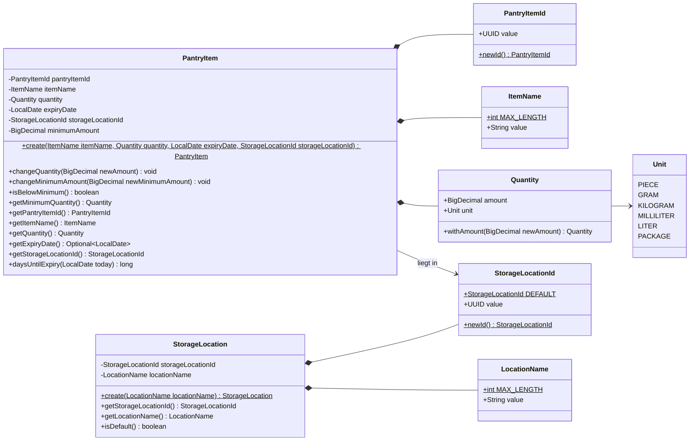
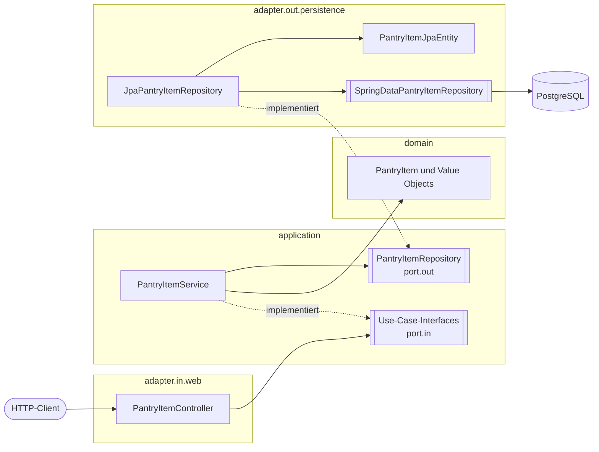
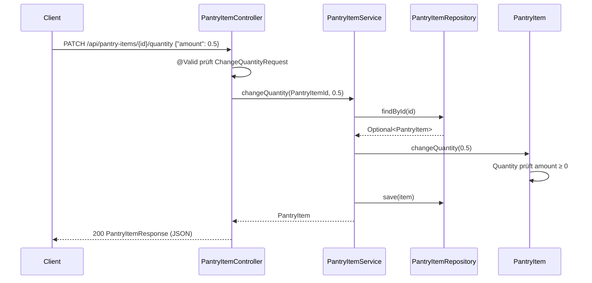
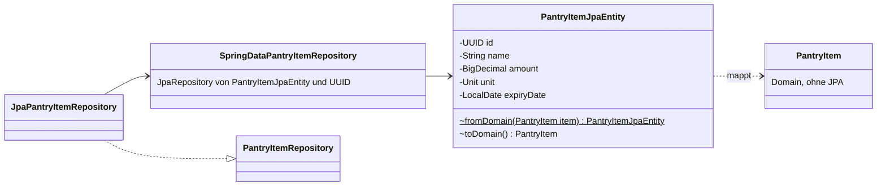

# Domain-Modell

Dieses Dokument beschreibt, wie die fachlichen Klassen von StorageKeeper aufgebaut sind, welche Regeln sie garantieren und wie ein Request durch die Schichten läuft.  
Stand: M3 (Vorratsartikel mit Lagerorten, Ablauf-Abfrage, Mindestbestand sowie Filter und Paging; gespeichert in PostgreSQL).

## Grundbegriffe

| Begriff            | Bedeutung                                                                                                               | Umsetzung in Java                                            |
|--------------------|-------------------------------------------------------------------------------------------------------------------------|--------------------------------------------------------------|
| **Entity**         | Hat eine eigene Identität. Zwei Objekte sind gleich, wenn ihre ID gleich ist, auch wenn sich ihr Zustand unterscheidet. | Klasse; `equals`/`hashCode` nur über die ID                  |
| **Value Object**   | Hat keine Identität. Zwei Objekte sind gleich, wenn alle Werte gleich sind. Unveränderlich.                             | `record`                                                     |
| **Aggregate Root** | Einstiegspunkt für eine Gruppe zusammengehöriger Objekte. Änderungen laufen nur über ihn.                               | `PantryItem`                                                 |
| **Invariante**     | Regel, die für ein Objekt immer gilt.                                                                                   | Prüfung im Konstruktor; Verstoß → `IllegalArgumentException` |

Weil jede Klasse ihre Regeln im Konstruktor prüft, kann im Programm kein ungültiges Objekt existieren.
Das Paket `domain` hängt von keinem Framework ab (kein Spring, kein Jakarta); `ArchitectureTest` erzwingt das.

## Klassendiagramm

## Klassen im Detail

### `PantryItem` – Entity, Aggregate Root

Ein Produkt im Vorrat, z. B. „1 kg Reis, haltbar bis 01.03.2027“.

| Feld                | Typ                 | Pflicht | Regel                                                                                 |
|---------------------|---------------------|---------|---------------------------------------------------------------------------------------|
| `pantryItemId`      | `PantryItemId`      | ja      | unveränderlich                                                                        |
| `itemName`          | `ItemName`          | ja      | unveränderlich                                                                        |
| `quantity`          | `Quantity`          | ja      | änderbar über `changeQuantity`                                                        |
| `expiryDate`        | `LocalDate`         | nein    | `null` = kein Ablaufdatum; nach außen als `Optional`                                  |
| `storageLocationId` | `StorageLocationId` | ja      | Lagerort des Artikels; Verweis nur über die ID                                        |
| `minimumAmount`     | `BigDecimal`        | ja      | Mindestbestand in der Einheit des Artikels, ≥ 0; `0` = kein Mindestbestand (Standard) |

- **Anlegen:** `PantryItem.create(...)` erzeugt eine neue ID. Der öffentliche Konstruktor ist für das
  Wiederherstellen eines vorhandenen Artikels mit bekannter ID gedacht (z. B. später aus der Datenbank).
- **Ändern:** `changeQuantity(newAmount)` setzt eine neue Menge; die Einheit bleibt gleich.
  Eine negative Menge wird von `Quantity` abgelehnt.
- **Gleichheit:** nur über `pantryItemId`. Ein Artikel bleibt derselbe, auch wenn sich seine Menge ändert.
- **Ablauf:** `daysUntilExpiry(today)` liefert die Tage bis zum Ablaufdatum: `0` = läuft heute ab,
  negativ = schon abgelaufen. Das „heute“ wird übergeben, die Domain fragt nie selbst die Uhr
  (siehe Abschnitt „Ablaufdatum und aktuelle Zeit“). Ohne Ablaufdatum wirft die Methode
  eine `IllegalStateException`.
- **Mindestbestand:** `changeMinimumAmount(amount)` setzt ihn, `getMinimumQuantity()` liefert ihn als `Quantity`
  mit der Einheit des Artikels. Eine eigene Einheit hat der Mindestbestand bewusst nicht, damit „2 kg Mindestbestand
  bei einer Menge in Stück“ gar nicht erst entstehen kann. `isBelowMinimum()` ist `true`, wenn die Menge **kleiner**
  als der Mindestbestand ist; genau gleich viel gilt als ausreichend. Das ist die Grundlage für die Einkaufsliste in M4.
- **Lagerort:** Jeder Artikel liegt in genau einem Lagerort. `PantryItem` hält dafür nur die `StorageLocationId`,
  nicht das `StorageLocation`-Objekt selbst (siehe unten).

### `PantryItemId` – Value Object

Kapselt eine `UUID`. Ein eigener Typ statt einer nackten `UUID` verhindert, dass IDs verschiedener
Entities verwechselt werden, sobald es weitere gibt (z. B. Lagerorte in M3).

| Feld    | Typ    | Regel        |
|---------|--------|--------------|
| `value` | `UUID` | nicht `null` |

`newId()` erzeugt eine zufällige ID, `toString()` liefert nur die UUID (wird z. B. für die URL verwendet).

### `ItemName` – Value Object

| Feld    | Typ      | Regel                                                                                                                          |
|---------|----------|--------------------------------------------------------------------------------------------------------------------------------|
| `value` | `String` | nicht `null`, nicht leer; wird mit `strip()` von Leerzeichen befreit; höchstens `MAX_LENGTH` = 100 Zeichen (nach dem Strippen) |

### `Quantity` – Value Object

| Feld     | Typ          | Regel                                         |
|----------|--------------|-----------------------------------------------|
| `amount` | `BigDecimal` | nicht `null`, ≥ 0 (0 bedeutet „aufgebraucht“) |
| `unit`   | `Unit`       | nicht `null`                                  |

`BigDecimal` statt `double`, damit Mengen wie 0,1 exakt bleiben.
`withAmount(newAmount)` liefert eine **neue** `Quantity` mit gleicher Einheit; das Objekt selbst ändert sich nie.

### `Unit` – Enum

`PIECE`, `GRAM`, `KILOGRAM`, `MILLILITER`, `LITER`, `PACKAGE`.
Umrechnungen zwischen Einheiten gibt es bewusst (noch) nicht.

### `StorageLocation` – Entity, eigenes Aggregat

Ein Ort, an dem Vorräte liegen, z. B. „Kühlschrank“ oder „Keller“.

| Feld                | Typ                 | Pflicht | Regel                                               |
|---------------------|---------------------|---------|-----------------------------------------------------|
| `storageLocationId` | `StorageLocationId` | ja      | unveränderlich                                      |
| `locationName`      | `LocationName`      | ja      | eindeutig, ohne Rücksicht auf Groß-/Kleinschreibung |

- **Basis-Lagerort:** Genau ein Lagerort existiert von Anfang an: „Vorrat“ mit der festen ID
  `StorageLocationId.DEFAULT` (`00000000-0000-0000-0000-000000000001`). Er wird von der Migration angelegt.
  `isDefault()` liefert für ihn `true`.
- **Standard beim Anlegen:** Gibt der Nutzer beim Anlegen eines Artikels keinen Lagerort an,
  setzt `PantryItemService` den Basis-Lagerort ein. Ein angegebener Lagerort muss existieren.
- **Weitere Lagerorte** legt nur der Nutzer an (`POST /api/storage-locations`).
- **Eindeutige Namen:** `StorageLocationService` lehnt einen Namen ab, den es schon gibt („Keller“ = „keller“).
  Zusätzlich sichert ein Unique-Index in der Datenbank das ab.

**Warum nur die ID im Artikel?** Artikel und Lagerort sind zwei getrennte Aggregate: Ein Lagerort
existiert unabhängig von seinen Artikeln, und beide werden getrennt geändert. Würde `PantryItem` das
ganze `StorageLocation`-Objekt halten, müsste beim Laden eines Artikels immer der Lagerort mitgeladen werden,
und Änderungen am einen könnten versehentlich den anderen betreffen. Der Verweis über die ID hält beide unabhängig.

### `StorageLocationId` – Value Object

Wie `PantryItemId`: kapselt eine `UUID`, `newId()` erzeugt eine zufällige ID.
Zusätzlich gibt es die Konstante `DEFAULT` für den Basis-Lagerort.

### `LocationName` – Value Object

| Feld    | Typ      | Regel                                                                                                     |
|---------|----------|-----------------------------------------------------------------------------------------------------------|
| `value` | `String` | nicht `null`, nicht leer; wird mit `strip()` von Leerzeichen befreit; höchstens `MAX_LENGTH` = 50 Zeichen |

## Ablaufdatum und aktuelle Zeit

`GET /api/pantry-items/expiring?days=7` liefert alle Artikel, die in den nächsten `days` Tagen ablaufen
oder schon abgelaufen sind, sortiert nach Ablaufdatum. Artikel ohne Ablaufdatum tauchen nicht auf.

| `days`        | Ergebnis                                        |
|---------------|-------------------------------------------------|
| weggelassen   | 7                                               |
| `0`           | nur Artikel, die heute oder früher ablaufen     |
| `0` bis `365` | erlaubt; alles andere → `400`                   |

**Woher kommt „heute“?** Nicht aus `LocalDate.now()` mitten im Code, sondern aus einer
`java.time.Clock`, die per Konstruktor in `PantryItemService` kommt:

- **In der App** legt `config/ClockConfiguration` eine Systemuhr in der Zeitzone aus
  `storagekeeper.time-zone` an (`application.yaml`, Standard `Europe/Berlin`). Die Zeitzone entscheidet,
  wann ein neuer Tag beginnt. Ohne sie würde ein Server in UTC um 0:30 Uhr deutscher Zeit noch „gestern“ rechnen.
- **In Tests** wird eine feste Uhr übergeben (`Clock.fixed(...)`). „Heute“ ist dann immer derselbe Tag,
  und Tests wie „läuft in 3 Tagen ab“ liefern an jedem Tag dasselbe Ergebnis.

`Clock` ist Teil des JDK, deshalb braucht es dafür kein eigenes Port-Interface: Die Application hängt
weiterhin nur vom JDK ab, nicht von Spring.

Ablauf einer Abfrage:

1. `PantryItemService.listExpiringWithin(days)` bestimmt `today = LocalDate.now(clock)`.
2. Das Repository liefert alle Artikel mit `expiry_date <= today + days`. Gefiltert und sortiert wird
   in der Datenbank (Index aus Migration V3), nicht in Java.
3. Für jeden Artikel berechnet die Domain `daysUntilExpiry(today)`. Ergebnis ist ein
   `ExpiringPantryItem(item, daysUntilExpiry)` mit `expired()` = `daysUntilExpiry < 0`.

## Artikelliste: Filter und Paging

`GET /api/pantry-items` liefert die Artikel seitenweise und nach Name sortiert. Alle Filter sind optional und
werden mit UND verknüpft:

| Parameter           | Standard | Bedeutung                                         |
|---------------------|----------|---------------------------------------------------|
| `storageLocationId` | –        | nur Artikel in diesem Lagerort                    |
| `belowMinimum`      | `false`  | `true` = nur Artikel unter ihrem Mindestbestand   |
| `page`              | `0`      | Seite, beginnend bei 0                            |
| `size`              | `20`     | Einträge pro Seite, 1 bis 100                     |

Die Antwort ist ein Seitenobjekt: `{"content": [...], "page", "size", "totalElements", "totalPages"}`.

**Eigene Typen statt Spring Data:** Die Application-Schicht verwendet `PageQuery(page, size)` und
`ResultPage<T>(content, page, size, totalElements)` aus `application.port` statt `Pageable` und `Page`
von Spring Data. So hängt die Application weiterhin nicht von der Persistenz-Technik ab; erst
`JpaPantryItemRepository` übersetzt in `PageRequest` und zurück. `PageQuery` prüft selbst, dass `page ≥ 0`
und `size` zwischen 1 und 100 liegt.

**Filtern in der Datenbank:** Die Filter werden als JPA-`Specification`s formuliert
(`PantryItemSpecifications`: `inStorageLocation`, `belowMinimum`). `JpaPantryItemRepository` hängt nur die
Bedingungen an, die im `PantryItemFilter` gesetzt sind, und Spring Data erzeugt daraus eine SQL-Abfrage
mit `WHERE`, `ORDER BY name, id`, `LIMIT` und `OFFSET` plus eine `COUNT`-Abfrage für `totalElements`.
Sortiert wird zusätzlich nach `id`, damit Artikel mit gleichem Namen auf jeder Seite in derselben Reihenfolge
stehen und keiner auf zwei Seiten auftaucht.

## Schichten und Abhängigkeiten

- Abhängigkeiten zeigen immer nach innen: Adapter → Application → Domain.
- Die Application kennt nur die Interfaces in `port.out`, nicht deren Implementierung.

Beim Wechsel von der In-Memory-Liste (M1) auf PostgreSQL (M2) haben sich Service und Domain deshalb nicht geändert.

## Ablauf eines Requests

Beispiel: Menge ändern.

## Abbildung REST ↔ Domain

| JSON-Feld (`PantryItemResponse`) | Quelle im Domain-Modell          |
|----------------------------------|----------------------------------|
| `id`                             | `getPantryItemId().value()`      |
| `name`                           | `getItemName().value()`          |
| `amount`                         | `getQuantity().amount()`         |
| `unit`                           | `getQuantity().unit()`           |
| `expiryDate`                     | `getExpiryDate()` bzw. `null`    |
| `storageLocationId`              | `getStorageLocationId().value()` |
| `minimumAmount`                  | `getMinimumQuantity().amount()`  |
| `belowMinimum`                   | `isBelowMinimum()`               |

| JSON-Feld (`StorageLocationResponse`) | Quelle im Domain-Modell              |
|---------------------------------------|--------------------------------------|
| `id`                                  | `getStorageLocationId().value()`     |
| `name`                                | `getLocationName().value()`          |
| `defaultLocation`                     | `isDefault()`                        |

`ExpiringPantryItemResponse` (für `/expiring`) enthält dieselben Felder wie `PantryItemResponse`
plus `daysUntilExpiry` (aus `ExpiringPantryItem.daysUntilExpiry()`) und `expired` (aus `expired()`).

Die Request-DTOs (`AddPantryItemRequest`, `ChangeQuantityRequest`) prüfen Eingaben bereits per Bean Validation,
damit der Client verständliche Fehler bekommt. Die Domain prüft trotzdem selbst; sie ist die eigentliche Absicherung.

## Fehlerbehandlung

Alle Fehler werden als `application/problem+json` (RFC 9457, `ProblemDetail`) zurückgegeben.

| Ursache                                                                 | HTTP-Status |
|-------------------------------------------------------------------------|-------------|
| Ungültiger Request (Bean Validation, unbekannte `unit`, kaputtes JSON)  | 400         |
| Domain-Regel verletzt (`IllegalArgumentException`)                      | 400         |
| Artikel-ID unbekannt (`PantryItemNotFoundException`)                    | 404         |
| Lagerort im Request unbekannt (`StorageLocationNotFoundException`)      | 400         |
| Lagerort-Name existiert schon (`StorageLocationAlreadyExistsException`) | 409         |

## Persistenz

Gespeichert wird in PostgreSQL. Zuständig ist allein das Paket `adapter.out.persistence`.

### Tabelle `pantry_item`

Angelegt durch die Flyway-Migration `src/main/resources/db/migration/V1__create_pantry_item.sql`.

| Spalte                | Typ            | Null? | Herkunft im Domain-Modell                                                |
|-----------------------|----------------|-------|--------------------------------------------------------------------------|
| `id`                  | `UUID`         | nein  | `PantryItemId.value` (Primärschlüssel)                                   |
| `name`                | `VARCHAR(100)` | nein  | `ItemName.value`                                                         |
| `amount`              | `NUMERIC`      | nein  | `Quantity.amount`; `CHECK (amount >= 0)`                                 |
| `unit`                | `VARCHAR(20)`  | nein  | `Quantity.unit` als Name, z. B. `KILOGRAM`                               |
| `expiry_date`         | `DATE`         | ja    | `expiryDate`                                                             |
| `storage_location_id` | `UUID`         | nein  | `storageLocationId`; Fremdschlüssel auf `storage_location(id)` (seit V2) |
| `minimum_amount`      | `NUMERIC`      | nein  | `minimumAmount`; `CHECK (minimum_amount >= 0)`, Standard `0` (seit V4)   |

`NUMERIC` ohne feste Nachkommastellen speichert den Wert genau so, wie er kommt (`1.5` bleibt `1.5`).
Bei `NUMERIC(12,3)` käme `1.500` zurück, und `Quantity` würde dann nicht mehr als gleich gelten,
weil `BigDecimal.equals` die Nachkommastellen mit vergleicht.

### Tabelle `storage_location`

Angelegt durch die Flyway-Migration `src/main/resources/db/migration/V2__create_storage_location.sql`.

| Spalte | Typ           | Null? | Herkunft im Domain-Modell                                    |
|--------|---------------|-------|--------------------------------------------------------------|
| `id`   | `UUID`        | nein  | `StorageLocationId.value` (Primärschlüssel)                  |
| `name` | `VARCHAR(50)` | nein  | `LocationName.value`; Unique-Index auf `LOWER(name)`         |

Was V2 außerdem macht:

1. Legt den Basis-Lagerort „Vorrat“ mit der ID `00000000-0000-0000-0000-000000000001` an.
2. Fügt `pantry_item.storage_location_id` als Pflichtspalte mit Fremdschlüssel hinzu.
   Bereits vorhandene Artikel bekommen dabei den Basis-Lagerort.
3. Entfernt danach den Spalten-Default wieder: Neue Zeilen müssen den Lagerort ausdrücklich setzen.
   Den Standard „Basis-Lagerort“ setzt die Anwendung, nicht die Datenbank.

In `PantryItemJpaEntity` ist `storageLocationId` eine einfache `UUID`-Spalte und keine JPA-Beziehung
(`@ManyToOne`). Das passt zum Verweis über die ID im Domain-Modell; der Fremdschlüssel in der
Datenbank sorgt trotzdem dafür, dass kein Artikel auf einen nicht existierenden Lagerort zeigt.

### Migration V3

`V3__index_pantry_item_expiry_date.sql` legt einen Index auf `pantry_item.expiry_date` an.
Er beschleunigt die Abfrage „läuft bald ab“ (`expiry_date <= ? ORDER BY expiry_date`), sobald viele Artikel
gespeichert sind. Am Schema selbst ändert sich nichts.

### Migration V4

`V4__add_minimum_amount.sql` ergänzt `pantry_item.minimum_amount` (Pflicht, Standard `0`, nicht negativ).
Vorhandene Artikel bekommen dadurch „kein Mindestbestand“. Außerdem kommt ein Index auf
`storage_location_id` dazu, der das Filtern nach Lagerort beschleunigt.

### Domain-Klasse und JPA-Entity sind getrennt

JPA verlangt einen parameterlosen Konstruktor und veränderbare Felder. Würde `PantryItem` selbst
als `@Entity` markiert, müsste die Domain diese Zugeständnisse machen und von Jakarta abhängen,
was `ArchitectureTest` verbietet. Deshalb gibt es eine eigene Klasse `PantryItemJpaEntity`,
die nur im Persistence-Adapter sichtbar ist:

- `fromDomain(item)` übersetzt beim Speichern in eine Tabellenzeile.
- `toDomain()` baut beim Laden über den normalen Konstruktor ein `PantryItem` auf.
  Dabei laufen alle Domain-Prüfungen erneut; ungültige Daten in der Tabelle würden sofort auffallen.
- `SpringDataPantryItemRepository` ist ein Interface; die Implementierung erzeugt Spring Data zur Laufzeit.
- `JpaPantryItemRepository` implementiert den Port `PantryItemRepository` und ist die einzige Klasse,
  die der Rest der Anwendung (über das Interface) zu sehen bekommt.

### Schema-Änderungen

- Das Schema wird **nur** über Flyway geändert. Für jede Änderung kommt eine neue Datei
  `V2__…sql`, `V3__…sql` usw. hinzu; bereits ausgeführte Migrationen werden nie verändert.
- Hibernate legt keine Tabellen an (`spring.jpa.hibernate.ddl-auto: validate`). Es prüft beim Start nur,
  ob Entity und Tabelle zusammenpassen, und bricht sonst ab.