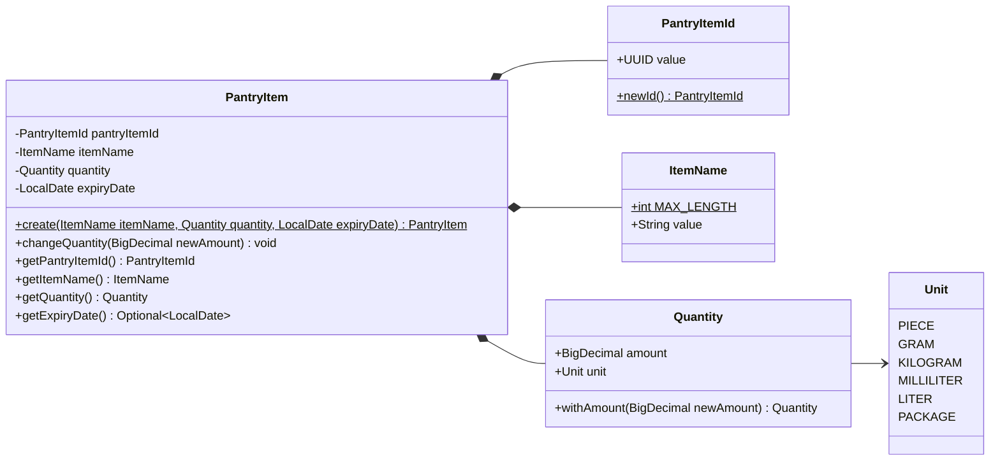
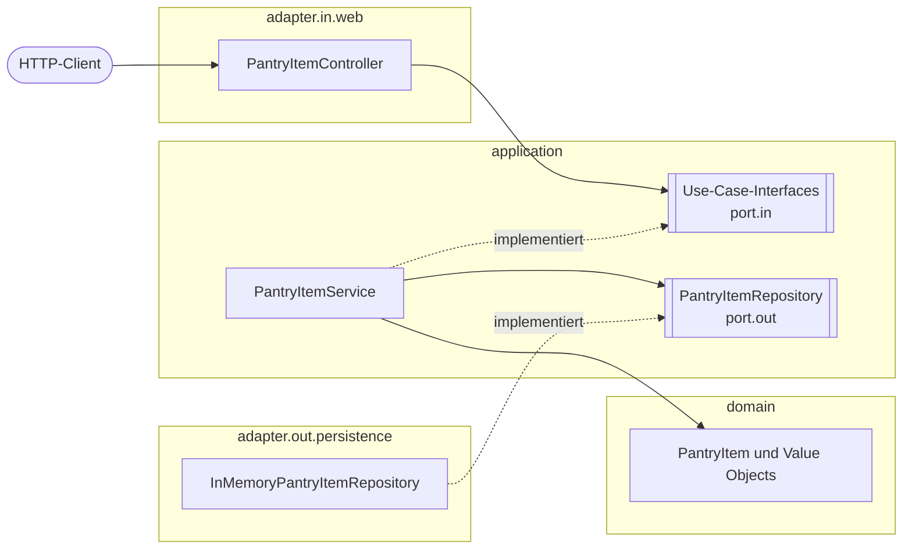
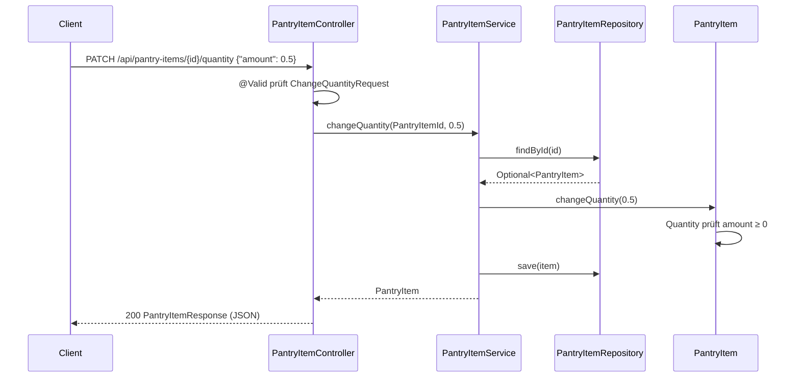

# Domain-Modell

Dieses Dokument beschreibt, wie die fachlichen Klassen von StorageKeeper aufgebaut sind, welche Regeln sie garantieren und wie ein Request durch die Schichten läuft.
Stand: M1 (Vorratsarktikel, In-Memory-Persistenz).

## Grundbegriffe

| Begriff            | Bedeutung                                                                                                               | Umsetzung in Java                                            |
|--------------------|-------------------------------------------------------------------------------------------------------------------------|--------------------------------------------------------------|
| **Entity**         | Hat eine eigene Identität. Zwei Objekte sind gleich, wenn ihre ID gleich ist, auch wenn sich ihr Zustand unterscheidet. | Klasse; `equals`/`hashCode` nur über die ID                  |
| **Value Object**   | Hat keine Identität. Zwei Objekte sind gleich, wenn alle Werte gleich sind. Unveränderlich.                             | `record`                                                     |
| **Aggregate Root** | Einstiegspunkt für eine Gruppe zusammengehöriger Objekte. Änderungen laufen nur über ihn.                               | `PantryItem`                                                 |
| **Invariante**     | Regel, die für ein Objekt immer gilt.                                                                                   | Prüfung im Konstruktor; Verstoß → `IllegalArgumentException` |

Weil jede Klasse ihre Regeln im Konstruktor prüft, kann im Programm kein ungültiges Objekt existieren.
Das Paket `domain` hängt von keinem Framework ab (kein Spring, kein Jakarta); `ArchitectureTest` erzwingt das.

## Klassendiagramm

## Klassen im Detail

### `PantryItem` – Entity, Aggregate Root

Ein Produkt im Vorrat, z. B. „1 kg Reis, haltbar bis 01.03.2027“.

| Feld           | Typ            | Pflicht | Regel                                                |
|----------------|----------------|---------|------------------------------------------------------|
| `pantryItemId` | `PantryItemId` | ja      | unveränderlich                                       |
| `itemName`     | `ItemName`     | ja      | unveränderlich                                       |
| `quantity`     | `Quantity`     | ja      | änderbar über `changeQuantity`                       |
| `expiryDate`   | `LocalDate`    | nein    | `null` = kein Ablaufdatum; nach außen als `Optional` |

- **Anlegen:** `PantryItem.create(...)` erzeugt eine neue ID. Der öffentliche Konstruktor ist für das
  Wiederherstellen eines vorhandenen Artikels mit bekannter ID gedacht (z. B. später aus der Datenbank).
- **Ändern:** `changeQuantity(newAmount)` setzt eine neue Menge; die Einheit bleibt gleich.
  Eine negative Menge wird von `Quantity` abgelehnt.
- **Gleichheit:** nur über `pantryItemId`. Ein Artikel bleibt derselbe, auch wenn sich seine Menge ändert.

### `PantryItemId` – Value Object

Kapselt eine `UUID`. Ein eigener Typ statt einer nackten `UUID` verhindert, dass IDs verschiedener
Entities verwechselt werden, sobald es weitere gibt (z. B. Lagerorte in M3).

| Feld    | Typ    | Regel        |
|---------|--------|--------------|
| `value` | `UUID` | nicht `null` |

`newId()` erzeugt eine zufällige ID, `toString()` liefert nur die UUID (wird z. B. für die URL verwendet).

### `ItemName` – Value Object

| Feld    | Typ      | Regel                                                                                                                          |
|---------|----------|--------------------------------------------------------------------------------------------------------------------------------|
| `value` | `String` | nicht `null`, nicht leer; wird mit `strip()` von Leerzeichen befreit; höchstens `MAX_LENGTH` = 100 Zeichen (nach dem Strippen) |

### `Quantity` – Value Object

| Feld     | Typ          | Regel                                         |
|----------|--------------|-----------------------------------------------|
| `amount` | `BigDecimal` | nicht `null`, ≥ 0 (0 bedeutet „aufgebraucht“) |
| `unit`   | `Unit`       | nicht `null`                                  |

`BigDecimal` statt `double`, damit Mengen wie 0,1 exakt bleiben.
`withAmount(newAmount)` liefert eine **neue** `Quantity` mit gleicher Einheit; das Objekt selbst ändert sich nie.

### `Unit` – Enum

`PIECE`, `GRAM`, `KILOGRAM`, `MILLILITER`, `LITER`, `PACKAGE`.
Umrechnungen zwischen Einheiten gibt es bewusst (noch) nicht.

## Schichten und Abhängigkeiten

- Abhängigkeiten zeigen immer nach innen: Adapter → Application → Domain.
- Die Application kennt nur die Interfaces in `port.out`, nicht deren Implementierung.
  In M2 wird `InMemoryPantryItemRepository` durch einen JPA-Adapter ersetzt, ohne dass sich Service oder Domain ändern.

## Ablauf eines Requests

Beispiel: Menge ändern.

## Abbildung REST ↔ Domain

| JSON-Feld (`PantryItemResponse`) | Quelle im Domain-Modell       |
|----------------------------------|-------------------------------|
| `id`                             | `getPantryItemId().value()`   |
| `name`                           | `getItemName().value()`       |
| `amount`                         | `getQuantity().amount()`      |
| `unit`                           | `getQuantity().unit()`        |
| `expiryDate`                     | `getExpiryDate()` bzw. `null` |

Die Request-DTOs (`AddPantryItemRequest`, `ChangeQuantityRequest`) prüfen Eingaben bereits per Bean Validation,
damit der Client verständliche Fehler bekommt. Die Domain prüft trotzdem selbst; sie ist die eigentliche Absicherung.

## Fehlerbehandlung

Alle Fehler werden als `application/problem+json` (RFC 9457, `ProblemDetail`) zurückgegeben.

| Ursache                                                                | HTTP-Status |
|------------------------------------------------------------------------|-------------|
| Ungültiger Request (Bean Validation, unbekannte `unit`, kaputtes JSON) | 400         |
| Domain-Regel verletzt (`IllegalArgumentException`)                     | 400         |
| Artikel-ID unbekannt (`PantryItemNotFoundException`)                   | 404         |
